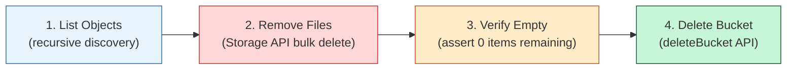

# Supabase Storage Cleanup & Purge Procedure

**Target:** Supabase Storage (`resumes` bucket)  
**Applicability:** Full Database & Storage Rollback / Teardown  
**Audience:** Platform Engineers & Database Administrators

---

## 1. Why Direct SQL Deletion of `storage.objects` is Prohibited

Supabase Storage is a hybrid system composed of:
1. **Metadata Catalog (`storage.objects` & `storage.buckets` in PostgreSQL):** Tracks filenames, MIME types, owner IDs, and bucket associations.
2. **Physical Object Storage Backend (AWS S3 / Google Cloud Storage / MinIO):** Stores the actual binary byte streams for each uploaded PDF file.

> [!CAUTION]
> Executing `DELETE FROM storage.objects WHERE bucket_id = 'resumes';` in PostgreSQL removes only the database metadata pointer. **It does not delete the physical files from cloud storage.** This creates permanent orphan binary assets that continue to consume storage space and incur cloud billing.
>
> To ensure complete deletion of both metadata and underlying physical binaries, files must always be purged via the **Supabase Storage API**.

---

## 2. The 4-Step Storage API Cleanup Procedure

When executing a rollback or removing the `resumes` bucket, complete the following 4 steps:



### Step 1: List all objects in the `resumes` bucket
Because files are stored under user subfolders (`<user_id>/<resume_id>.pdf`), the listing procedure must traverse folder prefixes to collect all file paths.

### Step 2: Remove objects using the Storage API
Call `supabase.storage.from('resumes').remove(paths)` passing batches of file paths. This instructs the storage service to delete the physical files from the storage backend and prune the catalog rows.

### Step 3: Verify the bucket is empty
Call `supabase.storage.from('resumes').list()` and assert that the returned item count is 0.

### Step 4: Delete the bucket
Call `supabase.storage.deleteBucket('resumes')` to safely remove the empty bucket.

---

## 3. Automated Cleanup Script (Node.js)

Run this script using Node.js and your Supabase `service_role` key (which has administrative rights over the Storage API):

```javascript
/**
 * scripts/purge-storage-resumes.js
 * Purges all resume objects and deletes the 'resumes' bucket via the Supabase Storage API.
 */
import { createClient } from '@supabase/supabase-js';

const SUPABASE_URL = process.env.SUPABASE_URL;
const SUPABASE_SERVICE_ROLE_KEY = process.env.SUPABASE_SERVICE_ROLE_KEY;

if (!SUPABASE_URL || !SUPABASE_SERVICE_ROLE_KEY) {
  console.error('Error: SUPABASE_URL and SUPABASE_SERVICE_ROLE_KEY environment variables are required.');
  process.exit(1);
}

const supabase = createClient(SUPABASE_URL, SUPABASE_SERVICE_ROLE_KEY, {
  auth: { persistSession: false }
});

async function purgeResumesBucket() {
  const bucketName = 'resumes';
  console.log(`Starting purge of Supabase Storage bucket: "${bucketName}"...`);

  // 1. Check if the bucket exists
  const { data: buckets, error: getBucketsError } = await supabase.storage.listBuckets();
  if (getBucketsError) throw getBucketsError;

  const bucketExists = buckets.some(b => b.id === bucketName);
  if (!bucketExists) {
    console.log(`Bucket "${bucketName}" does not exist. Nothing to purge.`);
    return;
  }

  // Helper to recursively collect all object paths
  async function listAllFiles(prefix = '') {
    const { data: items, error } = await supabase.storage.from(bucketName).list(prefix, {
      limit: 100,
      offset: 0,
      sortBy: { column: 'name', order: 'asc' }
    });
    if (error) throw error;

    let files = [];
    for (const item of items) {
      const fullPath = prefix ? `${prefix}/${item.name}` : item.name;
      if (item.id === null) {
        // Folder prefix: recurse into subdirectory
        const subFiles = await listAllFiles(fullPath);
        files = files.concat(subFiles);
      } else {
        files.push(fullPath);
      }
    }
    return files;
  }

  // Step 1: List all objects
  console.log('Step 1: Listing objects in bucket...');
  const allFiles = await listAllFiles();
  console.log(`Found ${allFiles.length} file(s) in "${bucketName}".`);

  // Step 2: Delete objects in batches of 50
  if (allFiles.length > 0) {
    console.log('Step 2: Removing objects via Storage API...');
    const batchSize = 50;
    for (let i = 0; i < allFiles.length; i += batchSize) {
      const batch = allFiles.slice(i, i + batchSize);
      const { data: deleted, error: deleteError } = await supabase.storage
        .from(bucketName)
        .remove(batch);

      if (deleteError) {
        throw new Error(`Failed to delete batch ${i} - ${i + batch.length}: ${deleteError.message}`);
      }
      console.log(`  ✓ Removed ${deleted.length} object(s).`);
    }
  }

  // Step 3: Verify bucket is empty
  console.log('Step 3: Verifying bucket is empty...');
  const remaining = await listAllFiles();
  if (remaining.length > 0) {
    throw new Error(`Verification failed: ${remaining.length} object(s) still remain in bucket!`);
  }
  console.log('  ✓ Verified: Bucket is completely empty.');

  // Step 4: Delete the empty bucket
  console.log(`Step 4: Deleting bucket "${bucketName}"...`);
  const { error: deleteBucketError } = await supabase.storage.deleteBucket(bucketName);
  if (deleteBucketError) {
    throw new Error(`Failed to delete bucket: ${deleteBucketError.message}`);
  }

  console.log(`✓ Storage cleanup completed: "${bucketName}" bucket and all files successfully purged.`);
}

purgeResumesBucket().catch((err) => {
  console.error('Purge script failed:', err.message);
  process.exit(1);
});
```

---

## 4. Alternative: Supabase Management Dashboard Purge

If preferred, the operation can be performed via the Supabase Web Dashboard:
1. Navigate to **Storage** in the left navigation sidebar.
2. Select the **`resumes`** bucket.
3. Select all top-level user folders and click **Delete**.
4. Confirm deletion of files and folder trees.
5. In the storage sidebar, click the `...` menu on the `resumes` bucket and choose **Delete bucket**.
